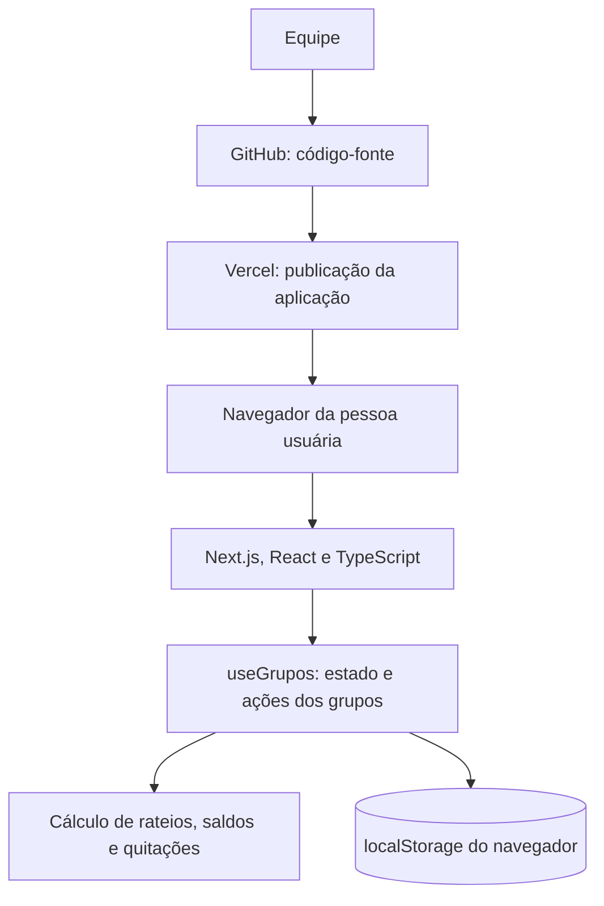

# Split&Go

Aplicação para organizar grupos e dividir despesas de viagens. O sistema permite cadastrar integrantes, registrar despesas em diferentes moedas e calcular os saldos e as quitações necessárias.

## Links

- **Aplicação publicada:** [Split&Go](https://split-and-go.vercel.app/)
- **Quadro do projeto:** [GitHub Projects](https://github.com/users/GuiSPFC/projects/3)

## Funcionalidades

- Criar e remover grupos.
- Adicionar e remover integrantes.
- Cadastrar despesas pagas por um integrante e divididas entre outros.
- Dividir despesas igualmente, por valores fixos ou por porcentagem.
- Registrar despesas em reais (BRL), dólares (USD) e euros (EUR).
- Calcular saldos individuais e sugerir quitações com menos transferências.
- Salvar os grupos no navegador usando localStorage.

## Tecnologias utilizadas

- **Next.js e React:** estrutura da aplicação e componentes da interface.
- **TypeScript:** tipagem dos dados e das funções.
- **CSS:** estilos da aplicação.
- **localStorage:** persistência dos dados no navegador.
- **Vercel:** hospedagem da aplicação.
- **GitHub:** repositório do código e quadro de acompanhamento do projeto.

## Arquitetura


Next.js e React permitem construir a interface com componentes e hooks, deixando a aplicação mais organizada. LocalStorage para persistência de dados porque ele consegue fazer essa função sem configurar um servidor, mas os dados ficam salvos somente no navegador de cada pessoa. Vercel para hospedar a aplicação pois já era do meu conhecimento e facilita atualizações a partir do GitHub. TypeScript ajuda a identificar inconsistências nos dados e nas funções de rateio durante o desenvolvimento.
Não há fila de processamento no MVP, pois as operações são feitas diretamente pela aplicação e não precisam ser executadas em segundo plano.

### Proposta de evolução do produto

### 1. Persistência em um banco de dados relacional

Substituir o localStorage por um banco PostgreSQL, assim as pessoas poderiam acessar os mesmos dados em diferentes dispositivos, colaborar nos grupos e continuar usando a aplicação sem depender dos dados salvos em um único navegador.

### 2. Login e compartilhamento de grupos

Permitir que cada pessoa crie uma conta, acesse seus grupos e convide outros integrantes. Isso tornaria a aplicação mais útil para viagens, também teria um controle de acesso para escolher quem pode visualizar ou alterar cada grupo.

### 3. Testes unitários

Criar testes automatizados para as regras de rateio, saldos, planos de quitação, divisões e etc... Os testes ajudariam a encontrar erros antes que chegue a um usuário, facilitando também a manutenção do código.

## Como executar localmente

### Pré-requisitos

- Node.js instalado.

### Instalação e execução

1. Clone o repositório do projeto no seu computador.

```bash
   git clone https://github.com/GuiSPFC/split-and-go.git
```

2. Entre na pasta da aplicação:

```bash
cd split-and-go/splitandgo
```

3. Na pasta do projeto instale as dependências e inicie o projeto rodando o comando:

```bash
npm install
npm run dev
```

4. Depois, acesse [http://localhost:3000](http://localhost:3000).

## Regras de rateio e casos de borda

1. Divisão igual com centavos restantes: quando o valor não pode ser dividido igualmente em centavos, o sistema distribui os centavos que sobram entre os primeiros participantes. Assim a soma das partes continua igual ao total da despesa.

2. Rateio por valores fixos: a despesa só é aceita quando todos os valores são válidos e a soma deles corresponde exatamente ao valor total.

3. Rateio por porcentagem: a despesa só é aceita quando os percentuais são válidos e somam exatamente 100%. Se o cálculo gerar centavos restantes, o sistema os distribui entre os participantes.

4. Despesas em moedas diferentes: os saldos e as quitações são calculados separadamente por moeda, mas o sistema não converte valores entre BRL, USD e EUR.

5. Grupo sem integrantes: não é possível cadastrar uma despesa antes de adicionar integrantes ao grupo.
